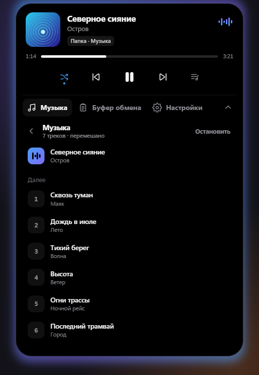
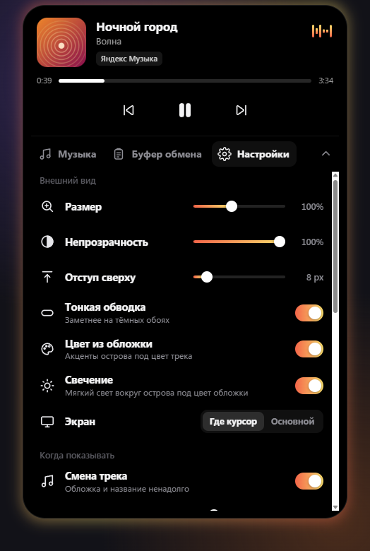
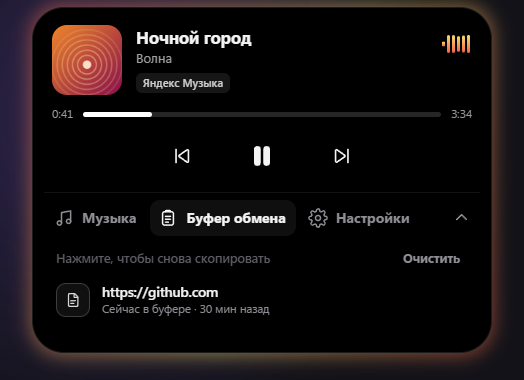

# Ostrov — Dynamic Island for Windows

**English** · [Русский](README.ru.md)

A small black pill at the top of your screen, just like on the iPhone. It shows what's playing, lets you control your music, remembers what you copy, and can play music from folders on your computer by itself.

## Features

- **Works with any player.** Spotify, Yandex Music, YouTube and VK in the browser, AIMP, Volna and more: cover art, seeking, play/pause, next and previous track.
- **Soft glow from the cover art.** The island glows in the colors of the current cover and slowly "breathes" while music is playing.
- **Clipboard.** Press Ctrl+C and a bubble with your text flies into the island. Your last 30 copied texts are always at hand — click one to put it back on the clipboard.
- **Music from folders.** Add a folder and Ostrov plays mp3, flac, m4a, ogg and wav on its own, with cover art, a queue and shuffle.
- **Everything in one island.** Settings and the clipboard slide down below the player — no separate windows.
- **Volume and media keys** right on the island.
- **Stays out of your way.** It doesn't pop up over full-screen games and videos and never steals focus from the window you're typing in.

  
  

  
  

The interface is currently in Russian.

## Installation

1. Download `Island.exe` from the [Releases](../../releases/latest) page.
2. Run it. Ostrov lives in the system tray next to the clock: left-click opens settings, right-click opens the menu.

Requires Windows 10 or 11. On first launch Windows may warn about an unknown publisher — click "More info" → "Run anyway".

**Hotkey:** `Ctrl+Alt+Space` by default — expand or hide the island. Scroll down over the player to open music, clipboard and settings.

## Privacy

Ostrov doesn't send anything to the internet. Copied text is kept in memory only and disappears when you quit, and texts that password managers mark as "do not store" are never remembered.
