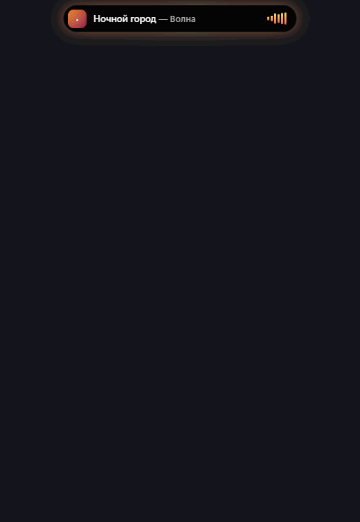
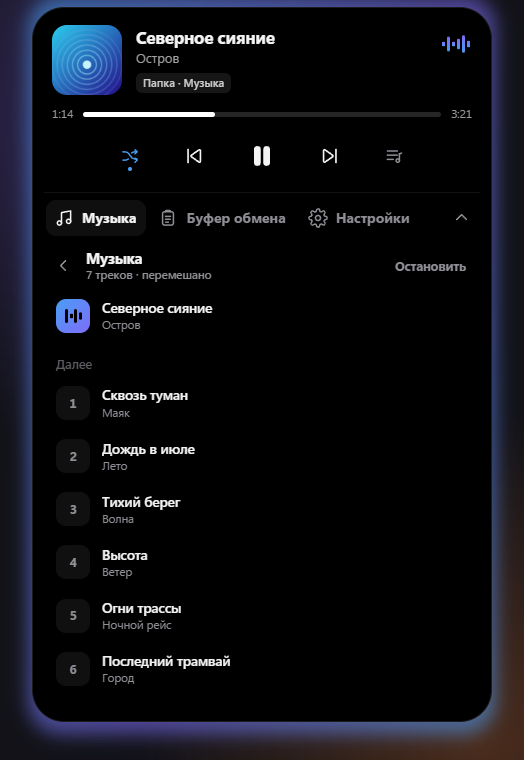
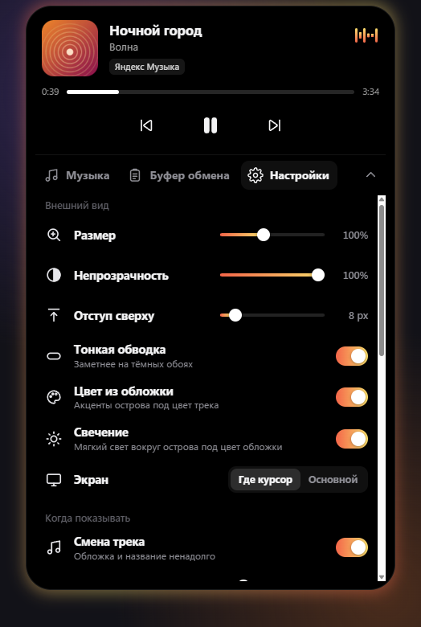
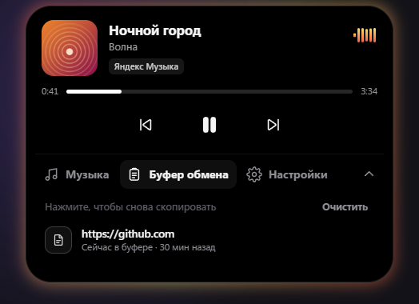

# Остров — Dynamic Island для Windows

[English](README.md) · **Русский**

Маленькая чёрная пилюля сверху экрана, как на iPhone. Показывает, что играет, даёт управлять музыкой, помнит скопированный текст и сама играет музыку из папок на компьютере.

## Что умеет

- **Любой плеер.** Spotify, Яндекс Музыка, YouTube и VK в браузере, AIMP, Волна и другие: обложка, перемотка, пауза, следующий и предыдущий трек.
- **Мягкий свет из обложки.** Вокруг острова светятся цвета текущей обложки и медленно «дышат», пока играет музыка.
- **Буфер обмена.** На Ctrl+C пузырь с текстом влетает в остров. Последние 30 текстов всегда под рукой, клик — и текст снова в буфере.
- **Музыка из папок.** Добавьте папку — Остров сам сыграет mp3, flac, m4a, ogg и wav, с обложками, очередью и перемешиванием.
- **Всё в одном острове.** Настройки и буфер выезжают вниз под плеером, отдельных окон нет.
- **Громкость и медиаклавиши** прямо на острове.
- **Не мешает.** Не всплывает поверх игр и видео на весь экран и не забирает фокус у окна, где вы печатаете.

  
  

  
  

## Установка

1. Скачайте `Island.exe` со страницы [Releases](../../releases/latest).
2. Запустите. Остров живёт в трее у часов: левый клик — настройки, правый — меню.

Нужны Windows 10 или 11. При первом запуске Windows может предупредить о неизвестном издателе — нажмите «Подробнее» → «Выполнить в любом случае».

**Горячая клавиша** по умолчанию `Ctrl+Alt+Пробел` — раскрыть или спрятать остров. Колёсико вниз над плеером открывает музыку, буфер и настройки.

## Приватность

Остров ничего не отправляет в интернет. Скопированный текст хранится только в памяти и пропадает при выходе, а тексты, которые менеджеры паролей помечают как «не сохранять», не запоминаются.
